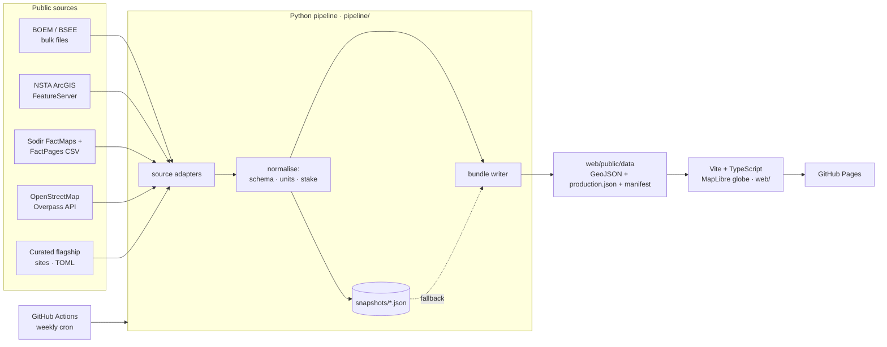

# Shell Asset Atlas

**An interactive 3D globe of Shell's operated assets, pipelines, production and retail network, built entirely from public regulator data and refreshed automatically every week.**

> Unofficial portfolio project. Not affiliated with, or endorsed by, Shell plc. No Shell logos or proprietary data are used.

| | |
|---|---|
| **210** installations & sites | **48** oil & gas fields with live production history |
| **5,941 km** of Shell-operated pipelines | **~1,030 kboe/d** gross, Shell-operated + JV (Dec 2025) |
| **28,180** Shell-branded fuel stations (OpenStreetMap) | **2,360** Shell Recharge / ubitricity charge sites |

*(Figures from the current data build. The site recomputes them on every refresh.)*

---

## What it does

- **3D globe, cinematic camera.** MapLibre GL v5 globe projection with atmosphere and pitched 3D views. Field polygons are extruded by production volume.
- **A decade of production you can replay.** Monthly volumes from three regulators (US BOEM, UK NSTA, Norway Sodir), normalised to kboe/d. Press play (or <kbd>Space</kbd>) and every platform and field grows and shrinks month by month. Hurricane shut-ins in the Gulf show up clearly.
- **Click anything.** Each asset has a details panel: production chart (liquids vs gas, plus Shell's *net* share where equity is public), water depth, install year, licensee equity table, and a link back to the regulator's record.
- **Data-driven guided tour** (<kbd>T</kbd>). A 12-stop narrative from the deepwater Gulf to Prelude FLNG. Every number in the story is computed from the live bundle, so the text stays accurate after each refresh.
- **Animated pipelines** coloured by product. Search with <kbd>/</kbd>, filter by stake (operated / JV / partner), and share deep links through the URL hash (camera, selected asset and month).
- **Self-healing data pipeline.** If a publisher is down during the weekly refresh, the build falls back to the last good snapshot and flags that source as *stale* in the UI instead of failing the deploy.

## Architecture



- **`pipeline/`**: dependency-light Python (only `requests`, no GDAL/GEOS) so it installs anywhere. One adapter per publisher converts everything into a single schema: `kind`, `stake` (`operated` / `jv` / `partner`), `region`, and production series in common units.
- **`web/`**: vanilla TypeScript with native MapLibre layers and no framework. Charts are a hand-written, dependency-free SVG component. Production bundle is about 300 KB gzipped.
- **`.github/workflows/refresh-and-deploy.yml`**: tests → fetch → commit refreshed snapshots → build → deploy to Pages, every Monday.

## Data sources

| Publisher | What's used | Licence |
|---|---|---|
| [BOEM / BSEE Data Center](https://www.data.boem.gov/) | Platform locations/master/structures, OGOR-A monthly production 2015→, pipeline master + vertices | US Government work |
| [North Sea Transition Authority](https://open-data-ukcs-transition.hub.arcgis.com/) | Field outlines + licensee equity, surface installations, pipelines, PPRS monthly field production | Open Government Licence v3.0 |
| [Norwegian Offshore Directorate (Sodir)](https://factpages.sodir.no/) | Field outlines, facilities, pipelines, licensee history, monthly field production | NLOD 2.0 |
| [OpenStreetMap](https://www.openstreetmap.org/copyright) | `amenity=fuel` + `brand=Shell`; Shell Recharge / ubitricity charge points | ODbL 1.0 |
| Curated (`pipeline/atlas/data/flagship.toml`) | ~25 global flagship sites (LNG, GTL, refineries, hydrogen, CCS) linked to Wikidata | — |
| [CARTO](https://carto.com/attributions) | Dark Matter basemap | CARTO basemap terms |

### Method notes

- **Shell entity matching.** BOEM: company numbers `00689` (Shell Offshore Inc.) and `02117` (Shell Gulf of Mexico Inc.), plus Shell pipeline companies. NSTA: `SHELL PLC`, and `ADURA ENERGY` (the 50/50 Shell–Equinor UK joint venture) shown as **JV**. Sodir: `A/S Norske Shell`, with stakes from the current licensee table.
- **Units.** Liquids (oil + condensate + NGL) in kbbl/d. Gas in MMscf/d. kboe/d uses 5,800 scf = 1 boe.
- **Gross vs net.** Volumes are gross (100%) for the operated asset. Shell's *net* is shown only where licence equity is published (UK, Norway).
- **Timeline cut-off.** The stacked timeline stops at the latest month all three regulators have published, so one regulator's reporting lag can't show up as a fake drop.
- **Hub mapping.** A few Gulf hubs book production under a neighbouring block's field code (Whale → AC772, Appomattox → MC392, Vito → MC940). These are mapped explicitly in `gom.py`.
- **Retail counts** reflect what OpenStreetMap volunteers have mapped, not Shell's official network size.

## Run it locally

Requires Python ≥ 3.11 with [uv](https://docs.astral.sh/uv/), and Node ≥ 20.

```bash
cd pipeline
uv run atlas-build            # fetch everything (~5 min; the Overpass query is the slow part)
uv run atlas-build --offline  # rebuild from committed snapshots in seconds
uv run --extra dev pytest -q
```

```bash
cd web
npm install
npm run dev                   # http://localhost:5173
```

## Deploy

1. Push to GitHub.
2. In **Settings → Pages**, set *Source* to **GitHub Actions**.
3. The workflow deploys on every push to `main` and refreshes the data every Monday. Use **Run workflow** to refresh on demand.

## Ideas for what's next

- Satellite overlays: Sentinel-5P methane and VIIRS flaring detections around upstream hubs, framed as emissions *verification*.
- Shell's "Report on Payments to Governments" as a country choropleth.
- More regulators: Netherlands (NLOG), Brazil (ANP), Australia (NOPTA).
- Vector-tile (PMTiles) output for the retail layer when it grows past ~100k points.

## Keyboard

<kbd>/</kbd> search · <kbd>Space</kbd> play/pause · <kbd>←</kbd>/<kbd>→</kbd> step month (or tour stop) · <kbd>T</kbd> tour · <kbd>Esc</kbd> close
