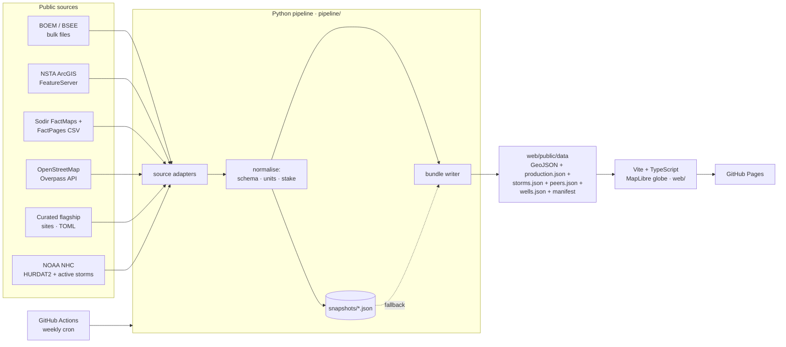

# Shell Asset Atlas

**An interactive 3D globe of Shell's operated assets, pipelines, production and retail network, built entirely from public regulator data and refreshed automatically every week.**

> Unofficial portfolio project. Not affiliated with, or endorsed by, Shell plc. No Shell logos or proprietary data are used.

| | |
|---|---|
| **210** installations & sites | **48** oil & gas fields with live production history |
| **5,941 km** of Shell-operated pipelines | **~1,030 kboe/d** gross, Shell-operated + JV (Dec 2025) |
| **28,180** Shell-branded fuel stations (OpenStreetMap) | **2,360** Shell Recharge / ubitricity charge sites |

*(Figures from the current data build. The site recomputes them on every refresh.)*

---

## What it does

- **3D globe, cinematic camera.** MapLibre GL v5 globe projection with atmosphere and pitched 3D views. Field polygons are extruded by production volume.
- **A decade of production you can replay.** Monthly volumes from three regulators (US BOEM, UK NSTA, Norway Sodir), normalised to kboe/d. Press play (or <kbd>Space</kbd>) and every platform and field grows and shrinks month by month. Hurricane shut-ins in the Gulf show up clearly.
- **Hurricane replay and storm risk.** NOAA best tracks for every storm since 2015 that passed within 150 km of a Shell structure in the Gulf (26 in the current build) are drawn over the timeline, coloured by Saffir-Simpson category, with the storm crossing the Gulf as the towers shrink. A storms panel estimates what each one deferred, hub by hub, and how many months the hub took to recover; click a storm to replay it. In the current build Ida (2021) is the largest, at an estimated 10.2 million boe gross. The panel also shows a snapshot of the National Hurricane Center's active Atlantic systems with their forecast cone and the Shell-operated production in the path.
- **Peer benchmark** (<kbd>B</kbd>). The same regulator files cover every operator, so a benchmark panel ranks Shell against the rest in the US Gulf, the deepwater Gulf, the UK and Norway. The bars re-rank as the timeline plays, a line chart follows each operator's share (or kboe/d) over time, and a headline states Shell's true rank and share for the month. It counts gross production by operator of record, not equity or net production, so Shell ranks low where it operates little. Adura, the Shell–Equinor joint venture, is listed as its own operator.
- **Below the waterline.** Open a deepwater Gulf hub and press **Dive below**: a full-screen 3D scene, drawn to true scale, drops from the platform through the water column to the seabed and on down the wells. Every wellbore BOEM ties to the hub is drawn from its public directional survey where one is on file (the few without one are dashed and labelled as schematic), coloured by status or spud year, with the Shell-operated pipelines laid on the seabed, a depth staff in metres and feet, and a Burj Khalifa on the seabed for scale. Under Perdido that is 80 wellbores in 2,388 m of water, the deepest ending 6,337 m below sea level. Hover a well for its API number, depth, spud date and status. Nothing is drawn for the geology, because there is no public data for it.
- **Click anything.** Each asset has a details panel: production chart (liquids vs gas, plus Shell's *net* share where equity is public), water depth, install year, licensee equity table, and a link back to the regulator's record.
- **Data-driven guided tour** (<kbd>T</kbd>). A 15-stop narrative from the deepwater Gulf, through a replay of Hurricane Ida, a dive below Perdido and a look at Shell among its Gulf peers, to Prelude FLNG. Every number in the story is computed from the live bundle, so the text stays accurate after each refresh.
- **Production towers and a live leaderboard.** Every producing hub carries a 3D column scaled to its gross kboe/d. A "top producers" bar-chart race re-ranks as the timeline plays; click a bar to fly there.
- **Three basemaps.** Dark vector, NASA Blue Marble with seabed relief (the continental shelf and deepwater canyons under the Gulf platforms), and NASA Black Marble night lights.
- **3D retail skyline.** One click turns 28,000 fuel stations from a heatmap into an extruded hexagonal density grid.
- **Colour by segment, water depth or install year,** with a matching legend. Hover any hub for a production sparkline.
- **Cinematic touches.** Fly-in from space over a parallax starfield, orbit camera (<kbd>O</kbd>), auto-playing tour, comet pulses running down trunk pipelines, cockpit read-out of position and altitude, fullscreen (<kbd>F</kbd>).
- **Animated pipelines** coloured by product. Search with <kbd>/</kbd>, filter by stake (operated / JV / partner), and share deep links through the URL hash (camera, selected asset, month, basemap, colour mode, storm tracks, the benchmark basin and an open subsea dive).
- **Self-healing data pipeline.** If a publisher is down during the weekly refresh, the build falls back to the last good snapshot and flags that source as *stale* in the UI instead of failing the deploy.

## Architecture



- **`pipeline/`**: dependency-light Python (only `requests`, no GDAL/GEOS) so it installs anywhere. One adapter per publisher converts everything into a single schema: `kind`, `stake` (`operated` / `jv` / `partner`), `region`, and production series in common units.
- **`web/`**: vanilla TypeScript with native MapLibre layers and no framework. Charts are a hand-written, dependency-free SVG component. Production bundle is about 320 KB gzipped. The subsea view is the one place a library is used: three.js, in its own chunk (about 140 KB gzipped) that is downloaded with `wells.json` only when a dive is opened.
- **`.github/workflows/refresh-and-deploy.yml`**: tests → fetch → commit refreshed snapshots → build → deploy to Pages, every Monday.

## Data sources

| Publisher | What's used | Licence |
|---|---|---|
| [BOEM / BSEE Data Center](https://www.data.boem.gov/) | Platform locations/master/structures, OGOR-A monthly production 2015→ (all operators for the peer benchmark), pipeline master + vertices, lease water depths, borehole file (`5010`, `BoreholeRawData`) and directional survey points (`dspts`) for the subsea view | US Government work |
| [North Sea Transition Authority](https://open-data-ukcs-transition.hub.arcgis.com/) | Field outlines + licensee equity, surface installations, pipelines, PPRS monthly field production (summed by organisation group for the peer benchmark) | Open Government Licence v3.0 |
| [Norwegian Offshore Directorate (Sodir)](https://factpages.sodir.no/) | Field outlines, facilities, pipelines, licensee history, field operator history, monthly field production | NLOD 2.0 |
| [OpenStreetMap](https://www.openstreetmap.org/copyright) | `amenity=fuel` + `brand=Shell`; Shell Recharge / ubitricity charge points | ODbL 1.0 |
| [NOAA National Hurricane Center](https://www.nhc.noaa.gov/data/#hurdat) | HURDAT2 Atlantic best tracks (storms that entered the Gulf, 2015→); `CurrentStorms.json` active systems with forecast track and cone (advisory KMZ) | US Government work |
| Curated (`pipeline/atlas/data/flagship.toml`) | ~25 global flagship sites (LNG, GTL, refineries, hydrogen, CCS) linked to Wikidata | — |
| [CARTO](https://carto.com/attributions) | Dark Matter basemap | CARTO basemap terms |

### Method notes

- **Shell entity matching.** BOEM: company numbers `00689` (Shell Offshore Inc.) and `02117` (Shell Gulf of Mexico Inc.), plus Shell pipeline companies. NSTA: `SHELL PLC`, and `ADURA ENERGY` (the 50/50 Shell–Equinor UK joint venture) shown as **JV**. Sodir: `A/S Norske Shell`, with stakes from the current licensee table.
- **Units.** Liquids (oil + condensate + NGL) in kbbl/d. Gas in MMscf/d. kboe/d uses 5,800 scf = 1 boe.
- **Gross vs net.** Volumes are gross (100%) for the operated asset. Shell's *net* is shown only where licence equity is published (UK, Norway).
- **Timeline cut-off.** The stacked timeline stops at the latest month all three regulators have published, so one regulator's reporting lag can't show up as a fake drop.
- **Hub mapping.** A few Gulf hubs book production under a neighbouring block's field code (Whale → AC772, Appomattox → MC392, Vito → MC940). These are mapped explicitly in `gom.py`.
- **Storm impact estimates.** Tracks are NHC HURDAT2 best tracks, from 2015 to the latest season NHC has published. A storm is kept if its centre passed within 150 km of a Shell structure in the Gulf while at tropical-storm strength (34 kt) or more. Distance is measured to the track between the six-hourly points, not only to the points. For each producing hub in range:
  - *Baseline* is the mean of the three months before the storm month.
  - *Recovered* is the first later month at or above 90% of baseline. The data is monthly, so recovery is counted in months.
  - *Deferred volume* is the sum of (baseline − actual) × days in the month, over the months before recovery. Volumes are gross.
  - *No estimate* is given when neither the storm month nor the next is below 90% of baseline, when the dip is smaller than twice the hub's month-to-month noise over the six months before, when production goes on to a clearly lower low, or when the hub is still down after 12 months. The last two look like a decline or a shutdown, not a storm.
  - *Two storms, one dip.* Monthly data cannot separate two storms in the same month, or a second storm that arrives before the hub has recovered. The stronger pass at the hub carries the estimate and the other is marked as counted under it, so no month is counted twice.

  These are estimates relative to a pre-storm baseline, not reported shut-in volumes. A planned turnaround in the same month looks the same in this data. Only hubs whose host platform is in the BOEM platform file can be placed near a track; production booked to field codes without a located Shell platform is not assessed.
- **Live storm risk.** The NHC active-storms feed sends no CORS header, so a browser cannot read it from another site. The pipeline snapshots it on every refresh instead, and the panel shows when it was checked. It is only as fresh as the last pipeline run (weekly by default), so it is not a warning service. For each active Atlantic system the forecast track and cone are read from the advisory's KMZ files. "Production in the path" is the latest reported month's gross kboe/d of the hubs inside the cone or within 150 km of the forecast track. It is not a forecast of shut-ins.
- **Peer benchmark.** `peers.json` holds monthly production by operator for each basin, over the same months as the timeline.
  - *Operator of record, gross.* An operator is credited with 100% of the field or lease it operates, whatever its working interest. This is not equity or net production, and it is not how companies report their own volumes. In Norway, Shell operates only Ormen Lange today (Draugen until 2018, Knarr and Gaupe until 2020–22), so it ranks well below Equinor there. In the UK, most former Shell-operated fields are reported under Adura from December 2025, so Shell itself ranks low and Adura is shown as its own operator.
  - *Sources.* US Gulf: the OGOR-A files already downloaded, summed by BOEM company number. UK: NSTA PPRS, offshore units only, summed by organisation group on the server. Norway: Sodir monthly field production joined to the field operator history, so a field counts for whoever operated it in the middle of that month.
  - *Grouping.* Legal entities are merged or renamed only by the `ENTITIES` table in `pipeline/atlas/peers.py` (for example Shell Offshore Inc. + Shell Gulf of Mexico Inc. → Shell; Chevron U.S.A. + Union Oil Company of California → Chevron; Statoil Petroleum + Equinor Energy → Equinor). An entity not in the table stays on its own under the regulator's name. Ownership that changed during the timeline is not merged: Hess, Anadarko, BG Norge and others stay as the regulator recorded them.
  - *Names follow the regulator.* BOEM and NSTA label history with each company's current name, so a predecessor's volumes appear under today's name (NSTA shows "Harbour Energy" in 2015, before that company existed). Sodir keeps the name of the time.
  - *Deepwater.* The Gulf deepwater cut keeps production from leases wholly in 1,000 ft (305 m) of water or more, BOEM's usual deepwater line. The platform file could place only about 40% of Gulf volume by depth, so the depth comes from BOEM's lease file (minimum and maximum water depth per lease), which places 99.9% of it. Leases that straddle the line (about 1% of volume) count as shelf.
  - *What is listed.* The top 12 operators of every month are kept, plus anyone who out-produced Shell or Adura in any month, so the ranks shown are exact. The rest is one "other operators" total. "N operators" counts those reporting at least 0.05 kboe/d in the month.
  - *Check.* Shell's Gulf figure here, and Shell plus Adura in the UK, equal the Shell-operated and JV totals on the timeline for every month, to rounding. In Norway they are equal for the latest month and higher in earlier years, because the timeline only carries fields Shell still holds a stake in.
- **Subsea view.** `wells.json` holds, for each deepwater Gulf hub, the wellbores below it as 3D paths and a small seabed grid. It is loaded only when a dive is opened.
  - *Which wells.* Boreholes in BOEM's borehole file whose operator number is `00689` or `02117`, in 1,000 ft of water or more, that were actually drilled. A borehole belongs to a hub when the file names the hub's platform complex as the well's complex (the host it was drilled from or is tied back to). A borehole with no complex on file, usually an exploration or appraisal well, is included when its bottom-hole field code is the hub's field code, and goes to the nearer hub if two share the code. The view says which rule applied. Wells of other operators are not drawn. BOEM counts every sidetrack and bypass as its own borehole, so "wellbores" is more than the number of wells.
  - *Paths.* From BOEM's directional survey points, a 140 MB download that is streamed and filtered and never committed. Each station gives measured depth, inclination and bearing, and also BOEM's own vertical depth and longitude/latitude offset. The paths use BOEM's positions. The minimum-curvature method is run on the same stations as a check: its vertical depth agrees with BOEM's to within 0.2 m on every one of the 837 surveyed boreholes in the current build. Its horizontal position differs by about one degree of bearing, which is what grid-north azimuths give when read as true north, and BOEM's offsets land on the reported bottom-hole location, so those are drawn. Paths are simplified (Douglas–Peucker in 3D) so that no surveyed point is more than about 5 m from the line.
  - *Depths* are metres below sea level: the files give feet below the rig's kelly bushing, and its elevation is subtracted. "Hole drilled" counts an original hole from the seabed and a sidetrack from its kick-off depth, so shared hole is not counted twice.
  - *Schematic fallback.* A borehole with no survey (38 of 875 in the current build) is drawn as a straight dashed line from the seabed to the reported bottom-hole location and labelled "schematic (surface to bottom-hole)". Where a sidetrack's survey starts at its tie-in, the part above the first station is straight.
  - *Seabed.* Interpolated (inverse-distance weighting) from the water depths BOEM records at borehole sites of all operators around the hub, plus the hub's own depth. It is not a bathymetric survey and is labelled as interpolated. Pipelines are laid on this surface.
  - *Not drawn.* Reservoirs, salt and formations: there is no public data for them here. The platform marker and line widths are not to scale.
- **Retail counts** reflect what OpenStreetMap volunteers have mapped, not Shell's official network size.

## Run it locally

Requires Python ≥ 3.11 with [uv](https://docs.astral.sh/uv/), and Node ≥ 20.

```bash
cd pipeline
uv run atlas-build            # fetch everything (~5 min; the Overpass query and the 140 MB BOEM survey file are the slow parts)
uv run atlas-build --offline  # rebuild from committed snapshots in seconds
uv run --extra dev pytest -q
```

```bash
cd web
npm install
npm run dev                   # http://localhost:5173
npm test                      # storm-risk, peer-rank and subsea geometry unit tests (Node's own runner; needs Node ≥ 22.18)
```

## Deploy

1. Push to GitHub.
2. In **Settings → Pages**, set *Source* to **GitHub Actions**.
3. The workflow deploys on every push to `main` and refreshes the data every Monday. Use **Run workflow** to refresh on demand.

## Explainer film

A narrated explainer of about five and a half minutes is filmed from the real app, one exact frame at a time. A script moves a cursor over the real controls while the page's clock is stopped between frames, so every render comes out the same. It opens on the dive below Perdido, then goes from the globe to a decade of production, the replay of Hurricane Ida, the peer benchmark, the subsea view in full, the wider portfolio and the method.

- **`film/scenes.py`** is the story: each narrated line and each click, in order. Every number spoken is read from the data bundle, so a render after a data refresh stays true. If the data no longer supports a line, the render stops and says which.
- **`film/render.py`** is the machinery: voice, frame loop, sound mix, captions and storyboard. The app's clock, the storm replay and the three.js dive all run on the film's clock, so the film can show them slowed down and still come out the same every time.
- **`film/overlay.js`** adds the cursor and the title, chapter and end cards.

```bash
python film/render.py --storyboard   # storyboard, script, captions, thumbnail, YouTube text (~10 min; longer the first time, while the voice is made)
python film/render.py                # the 1080p film and all of the above (~2 hours)
python film/render.py --remix        # rebuild only the sound on the last render
```

It needs `playwright`, `imageio-ffmpeg`, `kokoro-onnx`, `soundfile`, `numpy` and Microsoft Edge with WebGL (the subsea view is filmed on the GPU, like the map). The narration is a synthetic voice, Kokoro `af_heart`. Put `kokoro-v1.0.onnx` and `voices-v1.0.bin` from [kokoro-onnx](https://github.com/thewh1teagle/kokoro-onnx) in a folder and point `KOKORO_DIR` at it. The narration sets the timing: change a line and the picture retimes. To use a real voice, save a line as `film/out/vo/recorded/<id>.wav` (the ids are in `film/out/script.md`).

Everything is written to `film/out`. The videos and voice files are generated and aren't committed.

## Ideas for what's next

Ranked roughly by impact for the effort.

1. **Decline curves and a weekly brief.** A fitted decline curve and forecast fan per field, anomaly flags (start-ups, ramp-ups, unplanned outages), and an auto-written "what changed" page on each weekly refresh.
2. **Portfolio time machine.** Replay 2015 to today as acquisitions, divestments and start-ups. UK and Norway licensee history gives the equity changes; the rest would be curated and carries a stale-facts risk.
3. **Ask the Atlas.** A natural-language question box that answers by flying the globe and drawing the chart. Needs a small serverless proxy for the API key, so the site stops being purely static.
4. **LNG flows.** Animated cargo arcs from Shell-linked terminals. Public data is terminal-level, not cargo-owner-level, so the framing must say so.
5. **Emissions lens.** Carbon intensity per asset from EPA GHGRP, EU ETS and Norwegian facility data, with satellite overlays (Sentinel-5P methane, VIIRS flaring) framed as emissions *verification*. An unflattering number from an outsider could backfire, so sourcing and wording matter most here.

Also worth doing:

- Real bathymetry (NOAA or GEBCO grids) under the subsea view in place of the interpolated seabed.
- Shell's "Report on Payments to Governments" as a country choropleth.
- More regulators: Netherlands (NLOG), Brazil (ANP), Australia (NOPTA).
- Vector-tile (PMTiles) output for the retail layer when it grows past ~100k points.

## Keyboard

<kbd>/</kbd> search · <kbd>Space</kbd> play/pause · <kbd>←</kbd>/<kbd>→</kbd> step month (or tour stop) · <kbd>T</kbd> tour · <kbd>B</kbd> benchmark · <kbd>O</kbd> orbit · <kbd>F</kbd> fullscreen · <kbd>Esc</kbd> close
